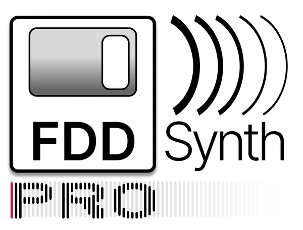
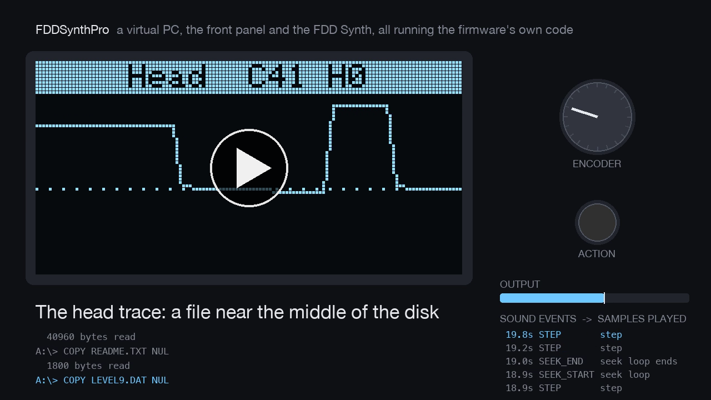
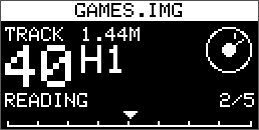
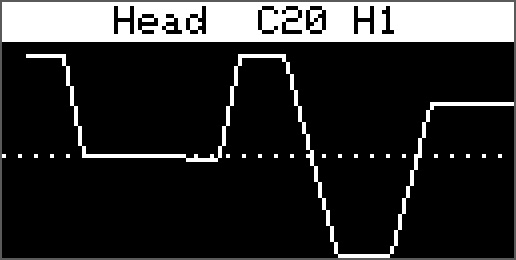

# FDD Synth Pro



An RP2350 that pretends to be a 3.5-inch floppy drive, GoTek style, as the base for a future FDD Synth that *is* the drive rather than one that listens to it. Being the drive, it knows exactly when the motor spins and how the head moves, so the sounds can follow every step.

At this stage it is a proof of concept on an Olimex RP2350-PICO2-BB48, tested from the same Mac that builds it. The host is a Feather RP2040 with an Adafruit Floppy FeatherWing, running Adafruit's Greaseweazle-compatible firmware, so the Greaseweazle tools (`gw`) drive it. See [docs/plan.md](docs/plan.md) for the slices and [docs/wiring.md](docs/wiring.md) for the connections. [docs/bringup.md](docs/bringup.md) is the checklist for hardware day, [docs/parts.md](docs/parts.md) the parts list, and [docs/wiring.html](docs/wiring.html) an interactive wiring diagram with a soldering checklist (open it in a browser).

It follows the approach of [HDDSynthPro](https://github.com/MaverickUK/HDDSynthPro), which does the same for IDE hard disks.

## See and hear it

[](https://cdn.jsdelivr.net/gh/MaverickUK/FDDSynthPro@main/media/showreel.mp4)

A 36-second showreel, with sound (click to play). A virtual PC uses a FAT12 disk while the front panel is worked: a disk chosen and swapped in, boot and `DIR`, reads with the volume turned down, the head trace following a long seek, a save, motor off and an eject. The screens, the drive and the sound are all the firmware's own code, run on the Mac in simulated real time, with the stand-in sample pack. `scripts/make_showreel.py` makes it. (The link plays it through jsDelivr, which serves the repo's copy as a video; GitHub's own link would download it.)

## Status

Slice 0 (listen only): the firmware records every drive select, motor, side, density and write-gate change and every head step it sees, without driving any pin, and streams the trace over USB serial.

The drive build (`pio run -e bb48_drive`, slices 1-3) is ready for when the hardware arrives:
- it tracks the head, and drives TRK00, a 300 RPM index, write protect and disk change;
- it streams a 720 KB or 1.44 MB image from the SD card on RDATA, or a generated disk without one;
- it takes writes back into the image, from single sectors to whole tracks;
- it swaps between the images on the card, GoTek style, including between 720 KB and 1.44 MB;
- it reports what it does as sound events (motor, clicks, seeks, bumps against the end stops, disk changes), and plays them with a sample pack through an I2S amp: the FDD Synth. See [docs/activity.md](docs/activity.md), `samples/Recorded/` for a sample pack cut from a recording of a real drive, and `samples/Placeholder/` for a synthesised stand-in.

Its logic is tested on the Mac against virtual hosts (the Feather's firmware and a Greaseweazle's), and its PIO program in a simulator whose output Greaseweazle's own decoder reads back. It has not run on hardware yet.

## Front panel

An SSD1306 OLED on the BB48's Qwiic socket, a rotary encoder and an action button, as on the HDD Synth. Turn for the volume; press to pick a disk from the card and insert it; the action button steps through the screens, and holding it ejects the disk. [docs/oled](docs/oled) has every screen, drawn by the firmware's own code.

 

## Quick start

```sh
test/run_native_tests.sh                 # C++ unit tests (no hardware)
brew install mtools dosfstools           # for the DOS disk tests
cd host && python3 -m venv .venv && .venv/bin/pip install -r requirements.txt
.venv/bin/pytest                         # simulator and parser tests (no hardware)

pio run -t upload                        # build and flash the BB48
pio device monitor                       # h help, p pin levels, s stats

scripts/rig.sh -m slice0                 # everything, against the real host
```

Read the power-order rule in [docs/wiring.md](docs/wiring.md) before connecting the host.

## Licence

To be decided (HDDSynth_Native is GPL-3.0).
