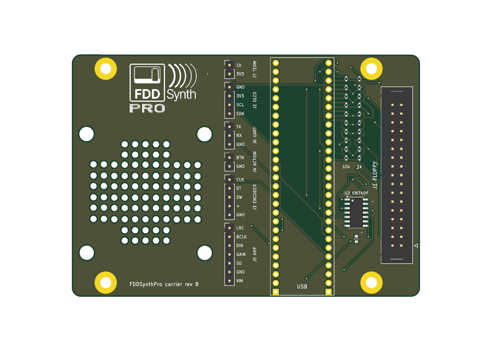

# FDDSynthPro carrier board

A KiCad 10 project for the board the Olimex RP2350-PICO2-BB48R plugs onto: the SN7407, the floppy header, the input pull-ups, and headers for the front panel and the amp. It's the circuit in [docs/wiring.md](../docs/wiring.md), with the pin map in [src/config.h](../src/config.h).

**Rev B** has the HDD Synth MK5's outline, mounting holes and speaker grille, so it fits the same case. It's built for JLCPCB assembly: they fit everything but the BB48R, which is marked DNP (do not populate) and plugged in by hand.



## The board

- **The outline**, 100.3 × 69.9 mm, is copied from the HDD Synth MK5's own PCB ([mk5_outline.py](mk5_outline.py)). That includes its speaker grille, the four 4.1 mm speaker-mounting holes, and the four M3 mounting holes (plated and grounded, as on the MK5). No copper goes under the speaker.
- **The speaker** is Pimoroni's mini speaker (4 Ω, 3 W, JST-PH): 40 × 40 × 20 mm, M2.5 holes 32.5 mm apart. On the MK5's holes (34 mm apart, 4.1 mm across) it covers x 1.3–41.3 mm; the nearest part (the header column) starts 2.3 mm beyond its frame. The MK5's holes are 0.75 mm wider-spaced than the speaker's on each side, which an M2.5 screw in a 4.1 mm hole just takes.
- **The BB48R stands upright, turned round:** its USB-C socket is at the bottom edge and its microSD slot (on its underside) at the top edge. Turned this way, its EXT1 row, which carries every floppy signal, faces J1, and its EXT2 row, with the amp and encoder pins, faces the headers. The pin map is unchanged. The case may need openings for both; the HDD Synth's USB-C sits on the right edge instead.
- **J1, the floppy box header,** is on the right, between the right-hand mounting holes, turned round so its signal row faces the BB48R.
- **The pull-ups:** the twenty 0402 resistors stand between the BB48R and J1, one 10 kΩ and one 1 kΩ on each input's row. Each input runs straight along its row through both, and their other ends drop through vias to two buses on the underside.
- **The SN7407 (U2)** and its 100 nF capacitor sit below the pull-ups, beside GP4–7, its inputs.
- **The headers** form one column on the left, between the speaker and the BB48R, labelled pin by pin and titled beside each group.
- **Tracks:** 0.3 mm everywhere (ground, 3.3 V and VBUS all cross under the BB48R, between its pins, where nothing wider fits), 0.2 mm clearance, 0.6/0.3 mm vias, and ground poured on both sides. A 0.3 mm track carries about 1 A.

## The circuit

| Ref | Part | LCSC | Fitted by | Notes |
|---|---|---|---|---|
| U1 | Olimex RP2350-PICO2-BB48R | — | You (DNP) | Two 1×27 female headers are best: they give the microSD card room underneath and let you swap the board |
| U2 | SN7407DR, SOIC-14 | C40481 | JLCPCB | The five outputs: GPIO → A, Y → floppy header. Powered from VBUS; the sixth gate's input is tied to GND (see the pin 2 rework below) |
| C1 | 100 nF, 0603 | C14663 | JLCPCB | U2's decoupling |
| R1–R10 | 10 kΩ, 0402 | C25744 | JLCPCB | Pull-ups on the ten inputs to 3.3 V: right for the FeatherWing host |
| R11–R20 | 1 kΩ, 0402 | C11702 | JLCPCB | Pull-ups to PC_TERM, which J7 joins to 3.3 V |
| J1 | 2×17 box header, straight | C9042 | JLCPCB | The floppy cable. Odd pins to ground; 4 and 6 unconnected |
| J2 | 1×4 header: GND, 3V3, SCL, SDA | C124378 | JLCPCB | SSD1306 OLED. The BB48R's own Qwiic socket carries the same I2C1 pins |
| J3 | 1×5 header: CLK, DT, SW, +, GND | C124379 | JLCPCB | Rotary encoder. A KY-040 module plugs straight in |
| J4 | 1×2 header | C124375 | JLCPCB | The action button, to GND |
| J5 | 1×7 header: LRC, BCLK, DIN, GAIN, SD, GND, Vin | C492406 | JLCPCB | Adafruit MAX98357A, in its own pin order. GAIN and SD unconnected |
| J6 | 1×3 header: TX, RX, GND | C124376 | JLCPCB | Debug UART on GP0/GP1 |
| J7 | 1×2 header and a jumper | C124375 | JLCPCB (the jumper cap: you) | **The termination switch:** off for the FeatherWing host (10 kΩ); on for a real PC (the 1 kΩ in parallel: 909 Ω) |

The BB48R's own pins are left alone: GP8 (PSRAM select), GP9–11 and GP24 (the microSD slot), and GP25 (the LED).

**Rework for Shugart and Amiga hosts:** rev B only reads floppy pin 2 (a PC's density select). Shugart and Amiga hosts want the drive to drive it, with DISK CHANGE. Lift U2 pin 13 from ground and wire it to GP23 (EXT1-27), wire U2 pin 12 to J1 pin 2, and set `pin02=chg` ([docs/wiring.md](../docs/wiring.md#pin-2-for-shugart-and-amiga-hosts-a-rework)). A rev C should route the sixth gate that way from the start.

Rev A had a socketed DIP SN7407 and solder jumpers (JP1–JP5) to bypass it for the `direct` builds. A soldered SOIC can't be taken out, so rev B always has its SN7407. The `direct` builds remain for hand-wired rigs.

## Ordering from JLCPCB

`hardware/build.sh` writes everything:

- `fddsynthpro_carrier_fab.zip`: the Gerbers and drill files. Upload it as it is: two layers, 1.6 mm, HASL or ENIG.
- `jlc/bom.csv` and `jlc/positions.csv`: the assembly BOM and placement (CPL) in JLCPCB's format, without U1 (DNP). KiCad's Fabrication Toolkit plugin writes its own set to `production/` (with "Exclude DNP" on, in `fabrication-toolkit-options.json`); either set works. Choose top-side assembly. J1–J7 are through-hole, so they need Standard PCBA rather than Economic.

Each part's LCSC number is in a field named **LCSC Part Number**, as on the HDD Synth, so KiCad's Fabrication Toolkit plugin fills its BOM from the schematic too; it also leaves U1 out when "Exclude DNP" is set. The pin headers are Ckmtw's `B-2100S0xP-A110`, as on the HDD Synth; Ckmtw makes no 1×7, so J5 is XFCN's `PZ254V-11-07P`.

**Before paying, check JLCPCB's placement preview.** Their footprints don't always share KiCad's zero angle, SOICs especially, so make sure U2's pin-1 dot matches the board's marking. Rotate it in the preview if not.

**Extended parts:** U2, J1 and the five different pin headers are JLCPCB "extended" parts, and JLCPCB charges a one-off loading fee for each extended part in an order. Fitting the 1×N headers yourself saves five of those fees: delete their lines from the BOM before uploading.

**Stock:** U2's stock was low (under 100) when checked. If it's out, TI's SN74LS07 is a hex open-collector buffer with the same pinout; check its datasheet's output sink current against the host's termination before swapping.

## Changing it

The schematic, board and assembly files are generated, so edit the pin map in `make_schematic.py` (and the placement in `make_pcb.py`) and rebuild:

```sh
hardware/build.sh                                             # expect 0 ERC and 0 DRC violations; takes about 2 minutes
cd host && .venv/bin/pytest tests/test_carrier_schematic.py   # the netlist against src/config.h
```

| File | What it is |
|---|---|
| `fddsynthpro_carrier.kicad_pro` | The project: open this in KiCad |
| `fddsynthpro_carrier.kicad_sch`, `.kicad_pcb` | The schematic and board (generated) |
| `fddsynthpro_carrier.kicad_dru` | One design rule: a ground thermal relief may have a single spoke (ground is also tracked) |
| `FDDSynthPro.kicad_sym`, `FDDSynthPro.pretty/` | The BB48R's symbol and footprint (measured from Olimex's own PCB) |
| `make_schematic.py`, `sexp.py` | The schematic's generator |
| `make_pcb.py` | The board's generator: placement, a rip-up-and-reroute maze router, the pours, the logo (about a minute) |
| `mk5_outline.py` | The HDD Synth MK5's outline and holes |
| `make_jlc.py` | Writes JLCPCB's BOM and placement files to `jlc/` |
| `build.sh` | Rebuilds it all, checks it (ERC, DRC with schematic parity) and writes the fabrication files |

`make_pcb.py` needs KiCad's own Python, for `pcbnew`; `build.sh` finds it in the macOS app (set `KICAD_PYTHON` elsewhere). The schematic test exports the netlist with `kicad-cli` and checks every connection against `src/config.h`; it skips where `kicad-cli` isn't installed (CI).

Editing the files by hand in KiCad works too, but the next run of the generators overwrites them. Once you start making changes by hand, stop running `build.sh`: the KiCad files become the source, and the test still checks the schematic against `config.h`.
