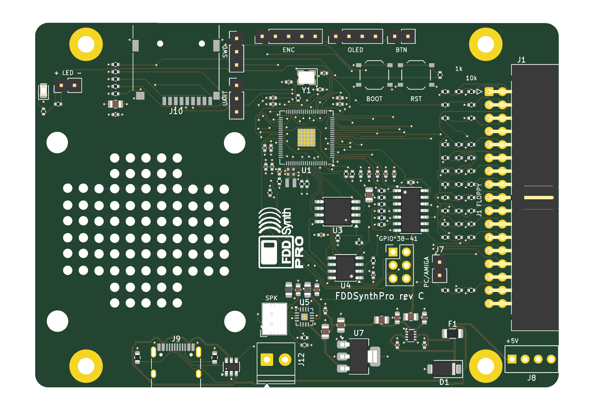

# FDDSynthPro rev C board

The integrated board: the RP2350B with its flash and PSRAM, the microSD socket, the floppy interface, the MAX98357A amp, and power from the floppy power connector or USB-C, on rev B's outline (the HDD Synth MK5's). The design and the reasons for it are in [docs/pcb-revc.md](../../docs/pcb-revc.md); the sled that fits it in a 3.5-inch bay is [hardware/mount/fddsynthpro_bay.scad](../mount/fddsynthpro_bay.scad).

Status: **not reviewed, not ordered.** The schematic passes ERC with 0 violations, and its netlist test passes. The board is placed and autorouted: DRC with schematic parity finds 0 unconnected items and 0 parity issues; its 7 warnings are connector outlines overhanging the edge, as meant. `build.sh` rebuilds and checks it all.



## Files

| File | What |
|---|---|
| `fddsynthpro_revc.kicad_pro` | The project: open this in KiCad 10 |
| `fddsynthpro_revc.kicad_sch` | Root sheet, with one sheet per block: `power`, `mcu` (RP2350B, flash, PSRAM), `floppy`, `audio` (the amp and the panel headers), `sd` |
| `fddsynthpro_revc.kicad_pcb` | The board: 4 layers (signals, GND plane, 3V3 plane, signals) |
| `fddsynthpro_revc.kicad_dru` | One rule: 0.125 mm spacing inside Raspberry Pi's regulator layout only (HDDSynthPro's) |
| `FDDSynthProRevC.kicad_sym`, `FDDSynthProRevC.pretty/` | The SN7407 and LM66200 symbols; the floppy power header's footprint; the logo; Raspberry Pi's inductor and wide-0402 footprints and the TF PUSH microSD socket (HDDSynthPro's) |
| `tools/gen_schematic.py` | Generates the schematic, with each part's LCSC number |
| `tools/layout_pcb.py` | Places the parts, Raspberry Pi's regulator copper and the planes |
| `tools/autoroute.py` | Routes with Freerouting, then pours ground on the outer layers |
| `tools/make_logo.py` | Makes the silkscreen logo (a board-only footprint) from `media/FDDSynthPro.png` |
| `tools/add_parts.py` | Adds parts the schematic has gained to the routed board, or moves parts on it (`--move`), so only their nets get routed |

The generators follow HDDSynthPro's (`../../HDDSynthPro/hardware/tools`). They bootstrap the design: once the files are edited in KiCad, those edits are the source, and rerunning a generator overwrites them.

To add a small part to the routed board without routing it all again (where there's room: the series resistors on the floppy inputs needed a full reroute, `build.sh`): add it to `gen_schematic.py` and to `PLACE` in `layout_pcb.py`, then

```sh
python tools/gen_schematic.py
"$KICAD_PYTHON" tools/add_parts.py prepare      # places it, locks the routing that's there
                                               # (or: prepare --move J5, to move a part and reroute its nets;
                                               #  prepare --rip NET, to route one net again)
FREEROUTING=... JAVA=... "$KICAD_PYTHON" tools/autoroute.py
"$KICAD_PYTHON" tools/add_parts.py finish       # unlocks it again
./build.sh --silkscreen
```

## Building and checking it

KiCad 10 is needed (the files are KiCad 10's format). On the Windows machine, a portable KiCad 10 lives in `%LOCALAPPDATA%\Programs\kicad10-portable`. It was unpacked from the installer, so it needs no admin rights, and its `env.sh` sets `KICAD_CLI`, `KICAD_PYTHON` and the library paths. Freerouting 2.5.0 and a Java 25 runtime are in `%LOCALAPPDATA%\Programs\freerouting`.

```sh
. "$LOCALAPPDATA/Programs/kicad10-portable/env.sh"
cd hardware/revc
python tools/gen_schematic.py                                   # the schematic
"$KICAD_CLI" sch erc fddsynthpro_revc.kicad_sch                 # expect 0 violations
"$KICAD_PYTHON" tools/layout_pcb.py                             # placement (overwrites the board)
FREEROUTING=<freerouting-2.5.0.jar> JAVA=<java.exe> "$KICAD_PYTHON" tools/autoroute.py
"$KICAD_CLI" pcb drc --refill-zones --save-board --schematic-parity fddsynthpro_revc.kicad_pcb
cd ../../host && KICAD_CLI="$KICAD_CLI" pytest tests/test_revc_schematic.py   # the netlist against src/config.h
```

On the Mac, KiCad's own paths work as for rev B: `KICAD_SHARE=/Applications/KiCad/KiCad.app/Contents/SharedSupport`, and KiCad's bundled Python for the layout and routing scripts.

## Ordering

Every part carries its LCSC number in a `LCSC Part Number` field (the Fabrication Toolkit plugin reads it). [docs/pcb-revc.md](../../docs/pcb-revc.md) lists the parts and their stock on 8 Nov 2026. Check these before ordering:
- **L1** (Raspberry Pi's 3.3 µH inductor) was out of stock.
- **The 16 MB flash** was down to 20.
- **J12,** the HDD Synth-style speaker terminal, is marked DNP (not fitted).
- **JLCPCB's placement preview:** check the rotations, above all the QFN-80, the inductor's polarity dot, the SOT-583, the TQFN-16 and the right-angle J1.
